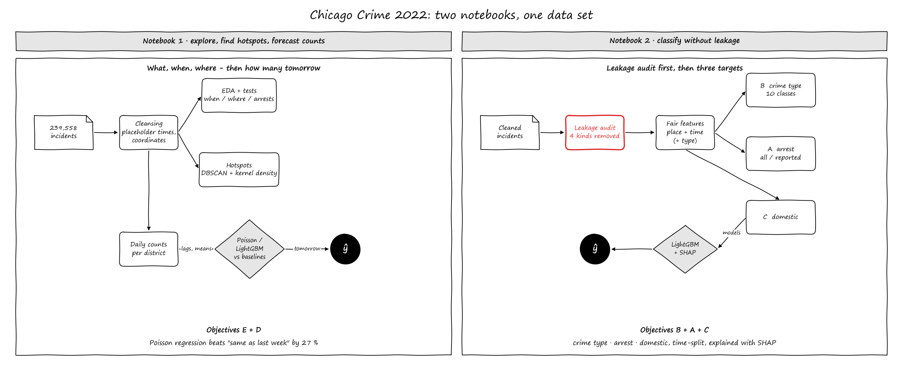
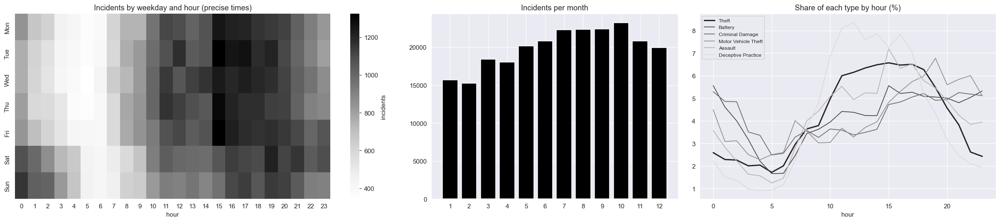
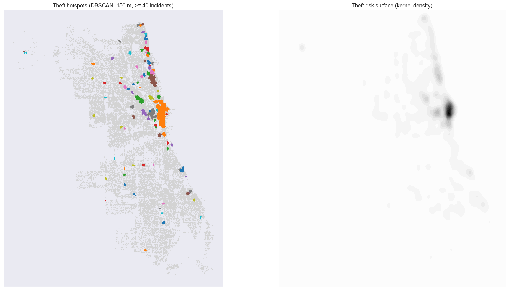
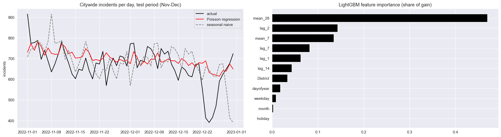
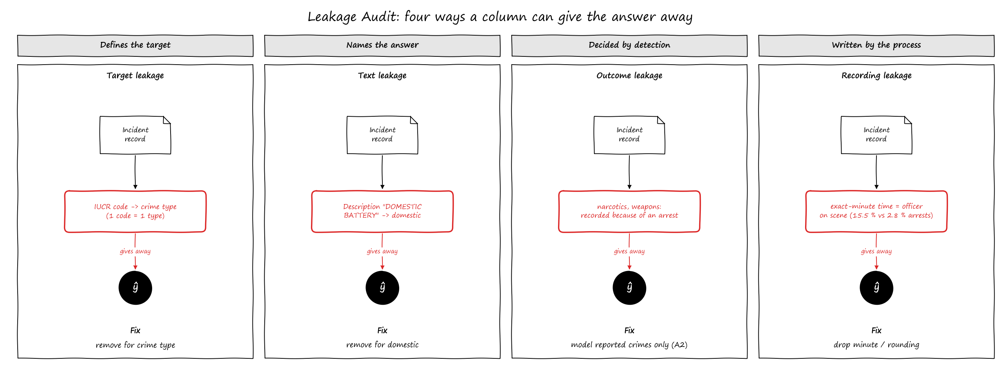
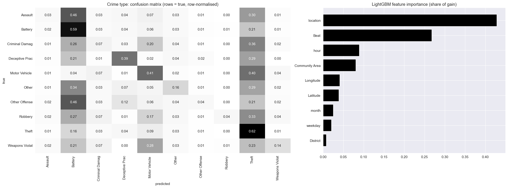
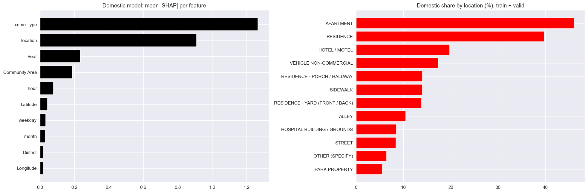

# Chicago Crime 2022: Exploration, Forecasting and Classification without Leakage

## [1/7] Overview

- **Data** → [Crime Prediction in Chicago 2022](https://www.kaggle.com/search?q=crime+prediction+in+chicago+2022) · 239,558 incidents · 1 Jan – 31 Dec 2022
- **Notebooks** → `chicago_crime_eda_forecasting.ipynb` (E exploration + hotspots, D forecasting) · `chicago_crime_classification.ipynb` (B crime type, A arrest, C domestic)
- **Idea** → clean the hidden recording artefacts, find what / when / where, forecast daily counts, then classify only with information a fresh report really has
- **Result** → Poisson forecast beats "same as last week" by 27 %; domestic PR-AUC 0.738, arrest 0.583 (0.276 for reported crimes), crime type top-3 66.4 %

| Objective | Metric | Baseline | Best model |
|---|---|---|---|
| D daily count per district | MAE | 7.60 (last week) | **5.51** (Poisson) |
| B crime type (10 classes) | top-3 accuracy | 49.0 % | **66.4 %** |
| A1 arrest, all crimes | PR-AUC | 0.101 | **0.583** |
| A2 arrest, reported crimes | PR-AUC | 0.069 | **0.276** |
| C domestic | PR-AUC | 0.167 | **0.738** |

## [2/7] Run on Kaggle

- **Import** → Create → Import Notebook → upload each `.ipynb`
- **Input** → the Chicago 2022 crime dataset (found anywhere under `/kaggle/input`)
- **Accelerator** → none (CPU, about 1 minute each)
- **Settings** → top cell of each notebook · `SAVE_FIGURES = False` → nothing is written

## [3/7] Data cleansing

- **Placeholder times** → 12,146 at 00:00, 6,455 at 12:00, 2,480 at 00:01 → hour analysis uses precise times only (62.3 %)
- **Placeholder dates** → 1,714 extra incidents on the 1st of a month
- **Not duplicates** → 90 rows share case numbers: all homicides, one row per victim → kept
- **Coordinates** → 4,667 missing and 2 outside Chicago → excluded from maps only

## [4/7] What, when, where

- **What** → theft, battery, criminal damage, car theft, assault = 69 % of incidents
- **When** → peak 15:00, quiet 05:00 (3.1×); summer +27 % over winter; no real weekday effect (p = 0.42)
- **Where** → 93 theft hotspots hold 32 % of thefts (downtown shopping area first); robbery and car theft are diffuse
- **Arrests** → follow detection: narcotics 97 % vs theft 4 %

## [5/7] Forecasting

- **Setup** → predict each district's count for each day of Nov–Dec from the days before; train Jan–Aug, tune Sep–Oct
- **Result** → Poisson regression MAE 5.51 vs 5.78 (28-day mean), 5.80 (LightGBM), 7.60 (last week)
- **Misses** → Christmas + Winter Storm Elliott (~390/day) and "1st of the month" spikes → weather and holiday features next

## [6/7] Leakage audit and classification

- **Removed** → IUCR / FBI code / description (define or name the target), police-initiated types for A2, and **timestamp precision**: exact-minute times end in arrest 15.5 % vs 2.8 % (officer on scene)
- **B crime type** → place identifies theft, battery, car theft and fraud; assault and robbery look like everything else
- **A arrest** → type first, then place: shoplifting in stores with security (22 %) vs 7.5 % average
- **C domestic** → apartments 46 % and residences 40 % vs ~1 % in stores

## [7/7] Next steps

- **Weather and holidays** → temperature, snow and school holidays for the forecast
- **Spatial models** → neighbouring beats as features, or a spatio-temporal model
- **More years** → 2001–today is public on the Chicago Data Portal; test whether patterns hold

The first version of this project is kept in `arch/`. Editable diagrams: `assets/*.drawio`.
